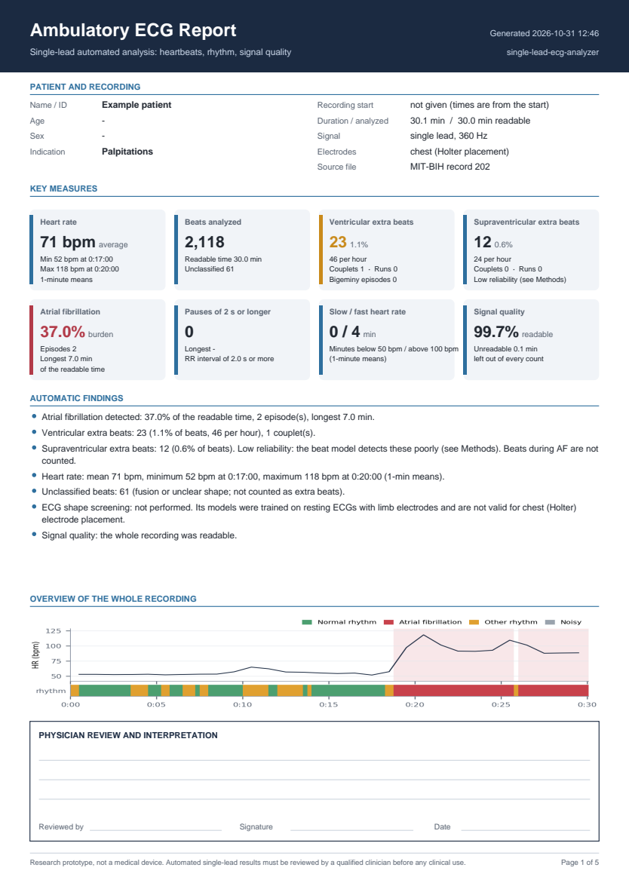
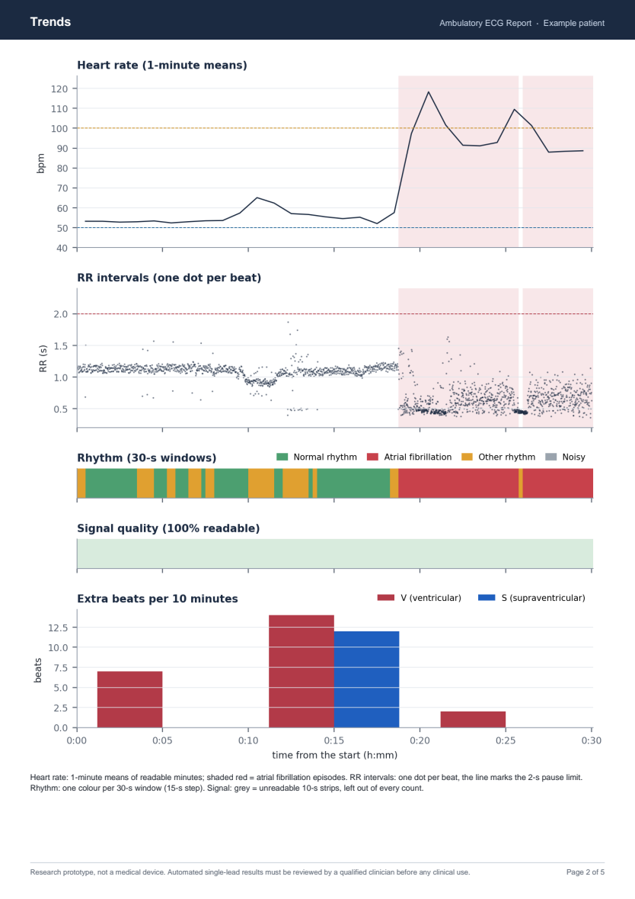
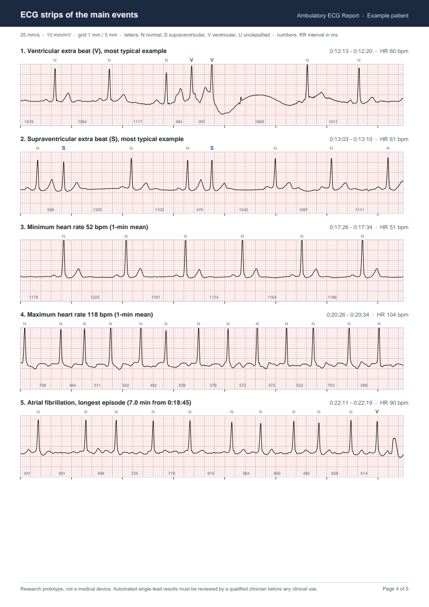
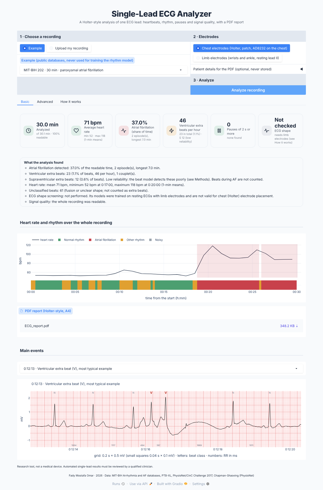
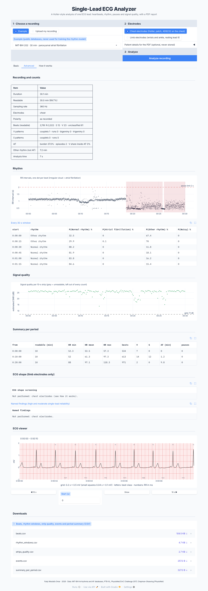

# Single-Lead ECG Analyzer

A Holter-style analysis of **one ECG lead**, from 10 seconds up to 24 hours. It checks the signal quality of
every 10-s strip, finds and classifies every heartbeat, reads the rhythm every 15 seconds, and turns all of it into the
measures a cardiologist reads in a Holter report: heart rate, extra beats and their patterns, pauses, atrial
fibrillation (AF) and its burden. It gives a short summary on screen and a **professional PDF report** with event
strips drawn to scale.

It is the capstone of three earlier projects, used exactly as published (fetched at pinned commits, never copied):

| Part | Project | What it does here |
|---|---|---|
| Heartbeats | [ecg-arrhythmia-detector](https://github.com/fady-mostafa-omar/ecg-arrhythmia-detector/tree/8909557eae9308712fd50456721ac8c9782b47a7) | R peaks + every beat classified N / S / V (AAMI) |
| Rhythm | [ecg-af-detector](https://github.com/fady-mostafa-omar/ecg-af-detector/tree/4554887d24f69d546be17153bbf0321d70edf4cc) | every 30-s window: normal, AF, other rhythm or noisy |
| Signal quality and ECG shape | [ecg-lead2-diagnosis](https://github.com/fady-mostafa-omar/ecg-lead2-diagnosis/tree/246bed3a80ed3271b72020d0529647e968e6583d) | quality gate per 10-s strip; 5 diagnostic groups (limb electrodes only) |

The goal behind it: a low-cost single-lead device (an AD8232 board) that gives the most useful analysis one lead can
honestly give. **Research prototype, not a medical device.**

## Sample report

A 5-page A4 report (MIT-BIH record 202, 30 min, paroxysmal AF): summary with a physician review box, trends, a table
per period with an event log, ECG strips at 25 mm/s and 10 mm/mV, and the methods with the validation numbers of the
three engines. [Open the PDF](docs/sample_report.pdf).

| Summary | Trends | ECG strips |
|---|---|---|
|  |  |  |

## The app

The **Basic** tab shows only what matters: six cards, the findings in plain words, one timeline of heart rate and
rhythm, the PDF, and the main events as ECG strips. **Advanced** has every number, the RR intervals, the signal quality
per strip, an ECG viewer and CSV downloads. **How it works** explains the method and its accuracy.

Advanced tab

Input: a CSV file (one column per lead, in millivolts) or a PhysioNet record (.hea + .dat), any sampling rate from
100 Hz. Optional patient details (name or ID, age, sex, reason) go into the PDF only and are never stored.

## How it works

1. **Polarity and units.** The recording counts as upside down when most R peaks of its first 10 minutes point down.
   Values that are clearly not millivolts are rescaled (and the report says so).
2. **Signal quality first.** Every 10-s strip gets an estimated signal-to-noise ratio (Project 3 gate). Strips below the
   gate are unreadable: every beat, window and strip inside them is left out of every count, so noise is never reported
   as a finding.
3. **Heartbeats.** R peaks are found once (Project 1 detector, 360 Hz, in 10-min chunks) and reused for the rhythm and
   the heart rate. Every beat is classified by Project 1's 5-network ensemble. Fusion and unclear beats are shown as
   unclassified (U).
4. **Rhythm.** Every 30-s window (15-s step) is read by Project 2's 5-member hybrid ensemble. AF windows are merged into
   episodes; AF burden = AF time / readable time. Supraventricular extra beats are not counted during AF (every beat
   is irregular there, so "premature" has no meaning).
5. **Holter measures.** Heart rate per minute (minutes with at least 40 s readable); pause = RR of 2.0 s or more; run =
   3 or more consecutive extra beats; couplets; bigeminy and trigeminy; minutes below 50 and above 100 bpm; a table per
   hour (per 10 min for recordings of 3 h or less); an event log; and the event strips for the report.
6. **Automatic warnings.** The report warns when AF episodes contain many ventricular extra beats (a known cause of
   false AF) and when many beats could not be classified.

## Results on real Holter recordings

The five recordings bundled with Project 2 (chest electrodes, expert annotations). Records 100, 200, 202 and 210 are
MIT-BIH DS2, never used to train the beat model; none of the five was used to train the rhythm model. AF burden is
computed over readable time for both the model and the cardiologists' annotations.

| recording | minutes | readable % | beats | V | S | unclassified | mean HR (bpm) | AF, cardiologists % | AF, model % | AF episodes | time (s) |
|---|---|---|---|---|---|---|---|---|---|---|---|
| MIT-BIH 100 | 30.1 | 99.7 | 2264 | 1 | 31 | 0 | 75.5 | 0.0 | 0.0 | 0 | 14.1 |
| MIT-BIH 200 | 30.1 | 87.5 | 2274 | 636 | 20 | 2 | 86.5 | 0.0 | 30.4 | 12 | 20.4 |
| MIT-BIH 202 | 30.1 | 99.7 | 2118 | 23 | 12 | 61 | 70.7 | 32.3 | 37.0 | 2 | 13.0 |
| MIT-BIH 210 | 30.1 | 99.1 | 2572 | 119 | 3 | 35 | 86.4 | 98.0 | 99.2 | 3 | 13.9 |
| AFDB 04043 (1 h) | 60.0 | 97.8 | 5955 | 233 | 21 | 1230 | 101.6 | 48.6 | 52.8 | 21 | 28.6 |

- AF burden is within 4.7 percentage points of the cardiologists on the three recordings with AF.
- **MIT-BIH 200 is a false alarm:** 30.4% AF burden with no AF. The record has
  636 ventricular extra beats, which make the rhythm irregular; 20% of the beats inside its AF episodes are V beats, so the report warns about it automatically.
- MIT-BIH 100 (normal rhythm): 1 V beat, no AF.
- AFDB 04043: 21% of the beats could not be classified (this database was never used to build the beat
  model); the report warns that its extra-beat counts may be unreliable.
- Speed on the free Colab CPU: about 30 s per hour of ECG.

## Accuracy of the three engines

Each number comes from the result files of the project's own repository (patients never used in training).

| Part | Test data | Sensitivity | PPV |
|---|---|---|---|
| V beats | MIT-BIH DS2, 22 patients, 3,095 V beats | 92.8% | 80.3% |
| S beats | MIT-BIH DS2, 1,824 S beats | 39.6% | 41.2% |
| Fusion beats | MIT-BIH DS2, 384 F beats | 0% | - |
| AF | CinC 2017 test, 152 AF recordings | 84.2% | 79.5% |
| AF | MIT-BIH DS2, 2,640 30-s windows | 93.9% | 75.2% |
| AF | MIT-BIH AF Database, 56,207 30-s windows | 93.7% | 97.2% |

ECG shape (limb lead II, 10-s resting ECGs): mean AUC over the five groups 0.864 on the PTB-XL test
fold and 0.852 on Chapman-Shaoxing (external). Quality gate: catches 94% of the
strips below 0 dB with 6% false rejections.

## A finding: the ECG-shape models do not transfer to chest electrodes

Project 3 learned ECG shape from resting hospital ECGs, where lead II is recorded with electrodes on the wrists and
ankle. Holter recordings place the electrodes on the chest, which changes the wave shapes. Forced to run on the five
chest-lead recordings, the models flagged the groups in this share of readable strips:

| recording | readable strips | NORM % | MI % | STTC % | CD % | HYP % |
|---|---|---|---|---|---|---|
| MIT-BIH 100 | 180 | 0.0 | 100.0 | 100.0 | 0.0 | 100.0 |
| MIT-BIH 200 | 158 | 0.0 | 100.0 | 100.0 | 98.1 | 100.0 |
| MIT-BIH 202 | 180 | 0.0 | 4.4 | 37.8 | 98.3 | 100.0 |
| MIT-BIH 210 | 179 | 0.0 | 9.5 | 100.0 | 14.0 | 100.0 |
| AFDB 04043 (1 h) | 352 | 0.0 | 10.5 | 100.0 | 100.0 | 100.0 |

"Normal ECG" was flagged in none of the strips and hypertrophy in every strip; in MIT-BIH 100, a normal-rhythm
recording, MI was flagged in 100% and ST/T change in 100% of the strips.
Rescaling the amplitude did not remove the effect, and resampling was ruled out (a PTB-XL strip taken 100 → 360 → 100 Hz
gives the same output). So the analyzer runs the ECG-shape step **only when the user chooses limb electrodes**; for chest
electrodes the report says it was not performed and why.

What it means for the device: for ECG-shape screening, record lead II at rest with the electrodes on the wrists and
the left ankle; for long recordings with chest electrodes, the analysis is heartbeats, rhythm and pauses.

## Limitations

- One lead cannot replace a 12-lead ECG or a cardiologist's review; findings are prompts for review, not diagnoses.
- S beats are detected poorly (sensitivity 40%) and fusion beats not at all.
- Frequent extra beats can be mistaken for AF: in Project 2's external test, MIT-BIH records 200 (27%), 228 (19%), 232 (17%) got false AF burden.
- The heartbeat and rhythm models were not measured on limb-electrode recordings, and the ECG-shape models only on
  resting 10-s ECGs.
- Tested on public databases only: not yet on the AD8232 board or on new patients.

## Future work

1. **Ectopy-aware AF detection**, to remove the false alarms caused by frequent extra beats (MIT-BIH 200).
2. **The full Chapman-Shaoxing external test** of the ECG-shape models (all 45,152 ECGs, GPU run, Project 3 step 3.6c).
3. **Real recordings with the AD8232 board on patients**, with both electrode placements, against a hospital Holter or
   12-lead ECG.
4. ECG-shape models for chest leads, trained or validated on Holter recordings with diagnoses.
5. Two channels (leads I and II, e.g. ADS1292R) for a better single-device screen.

## Run it yourself

    git clone https://github.com/fady-mostafa-omar/single-lead-ecg-analyzer.git
    cd single-lead-ecg-analyzer
    pip install -r requirements.txt
    python scripts/get_models.py        # the three projects at their pinned commits, into vendor/
    python app/app.py                   # the app, at http://127.0.0.1:7860
    python scripts/01_check_examples.py # results/ and docs/sample_report.pdf
    pytest -q

Or open the [Colab notebook](notebooks/single_lead_ecg_analyzer.ipynb) (free CPU runtime).

## Repository

| Path | Content |
|---|---|
| `src/holter/engine.py` | runs the three engines on one recording |
| `src/holter/derive.py` | Holter measures, events and findings text |
| `src/holter/report.py` | the PDF report |
| `src/holter/io.py` | CSV and PhysioNet input |
| `src/holter/validation.py` | accuracy numbers read from the three projects' result files |
| `src/holter/vendor.py` | the three projects and their pinned commits |
| `app/app.py` | Gradio app |
| `scripts/` | `get_models.py`, `01_check_examples.py` |
| `results/`, `docs/` | result tables, sample report, screenshots |
| `tests/` | unit and end-to-end tests (run on GitHub Actions) |

## Data

MIT-BIH Arrhythmia Database and MIT-BIH Atrial Fibrillation Database (Moody and Mark; PhysioNet), PhysioNet/CinC
Challenge 2017, PTB-XL (Wagner et al.; PhysioNet, CC BY 4.0), MIT-BIH Noise Stress Test Database, Chapman-Shaoxing
(Zheng et al.; PhysioNet). Goldberger et al., PhysioBank, PhysioToolkit, and PhysioNet, Circulation 2000.

Fady Mostafa Omar, 2026. MIT License.
